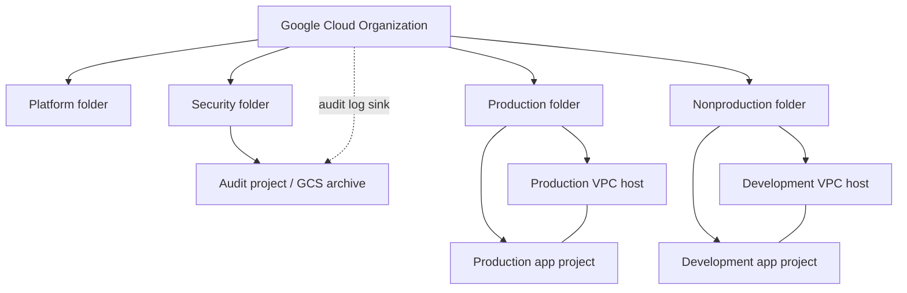

# Architecture and scope

## Resource hierarchy

## Layers

| Layer | Owns | Dependency | State isolation |
| --- | --- | --- | --- |
| bootstrap | Existing project's state storage bucket | GCP bootstrap project, billing | Local first → prefix bootstrap |
| foundation | Folders, five projects, optional guardrails, org log archive | Org/billing privileges, state bucket | prefix foundation |
| network | Shared VPC, subnet, routing, NAT, optional IAM | Foundation projects | prefix network |
| identity | GitHub Workload Identity Pool/Provider and unprivileged account | Existing identity project | prefix identity |

### Network trust boundaries

There are two independent Shared VPC **host projects**. This makes production/nonproduction separation more than a subnet label. Within each VPC, explicit subnets receive Private Google Access and VPC Flow Logs. Cloud NAT lets eligible private VMs make outbound connections without external addresses; it **does not block or inspect all egress**. The Google Cloud implicit ingress deny applies because we do not create allow-ingress firewall rules.

Actual workload placement, GKE, load balancing, service perimeter, VPC Service Controls, private connectivity, DNS strategy, egress filtering, endpoint policies and customer interconnect are **not** provisioned. These are planned extensions, not implemented features. Regional HA, quota validation, disaster recovery and application monitoring must be designed per workload.

### Identity and API use

The code never grants users the primitive Owner or Editor roles. A separate optional identity stack creates a Workload Identity provider restricted to GitHub's stable owner/repository IDs and the `main` branch. A service account is created without project permissions. No deployment role or admin role is granted automatically.

### Logging and retention

The organization aggregated sink exports audit logs (when produced) to a GCS bucket with uniform access, public access prevention and a 365-day object retention policy. The writer receives only `roles/storage.objectCreator` on that bucket. Data Access logs may need to be enabled separately, depending on the API/service. GCS export is **not** real-time SIEM monitoring or a managed search index. Design alerting and access review separately.

## Why separate states

This structure prevents a normal network operation from accidentally modifying organization policy or deleting the shared state bucket. Root-module boundaries also allow different approval rules. Cross-stack values are supplied explicitly in examples instead of implicitly reading another stack's state (which can expose sensitive state objects).

## Trade-offs

- Fewer project types keep the demonstration approachable but a mature enterprise may require dedicated management, KMS, security tooling, observability and CI projects.
- Full platform rollout should include **Cloud Billing budgets, alerting, SCC, centralized DNS, dedicated CI runners, policy-as-code**, and permission reviews, which are not fully implemented here.
- Org policies must be tested against existing workloads before enabling: they affect descendants, including unrelated applications.
- Terraform drift detection and apply are deliberately not automated because this is a publicly usable reference without access to the target organization.
